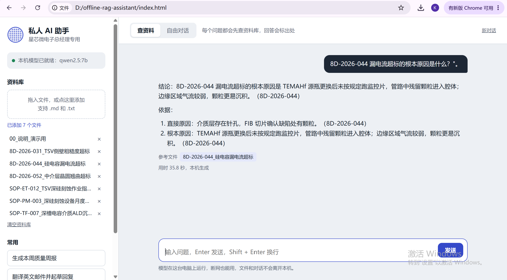
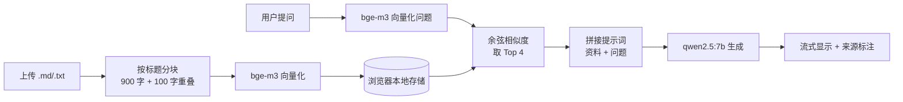

# Offline RAG Assistant · 本地离线 AI 知识库助手

一个单文件、零依赖的本地知识库问答助手。模型通过 [Ollama](https://ollama.com) 在本机运行，断网可用，文档和对话不会离开这台电脑。

A single-file, dependency-free RAG assistant that runs entirely on your own machine via Ollama. Works offline; no data leaves the device.

<!-- 截图：把演示截图放到 docs/screenshot.png 后取消下一行注释 -->


## 适用场景

制造业企业的工艺文件、SOP、异常报告（8D）等资料保密要求高，不适合上传到云端大模型。本项目演示了如何在一台普通笔记本上，用开源模型搭建一个只读本地文档、回答可追溯出处的问答助手。

`sample-docs/` 中提供了一套**完全虚构**的晶圆厂演示文档（虚构公司"星芯微电子"，参数均为模拟数据），可直接用来体验。

## 功能

- **查资料**：每个问题先在本地资料库检索，再由模型根据检索结果作答，并标注来源文件编号
- **质量周报**：一键汇总资料库中的全部 8D 报告，输出"问题 / 根因 / 措施 / 状态 / 需决策事项"表格
- **自由对话**：不查资料库，用于写邮件、翻译等日常任务
- **流式输出**、随时停止生成
- 资料库保存在浏览器本地存储中，关闭页面后不会丢失
- 自动适配浅色 / 深色模式

## 架构



各模块的详细说明见 [docs/ARCHITECTURE.md](docs/ARCHITECTURE.md)。

## 快速开始

**1. 安装 Ollama 并下载模型**

```bash
ollama pull qwen2.5:7b   # 对话模型
ollama pull bge-m3       # 中文嵌入模型
```

**2. 允许网页访问本机 Ollama**（只需设置一次）

Windows：
```bash
setx OLLAMA_ORIGINS "*"
```
macOS / Linux：
```bash
launchctl setenv OLLAMA_ORIGINS "*"   # macOS
# Linux: 在 ollama 服务的环境变量中加入 OLLAMA_ORIGINS=*
```
设置后需**完全退出并重新启动 Ollama**。

**3. 打开助手**

双击 `index.html`，用浏览器打开。左上角显示绿点即连接成功。把 `sample-docs/` 中的文件拖进左侧"资料库"，然后试试：

- TSV 侧壁粗糙历史上是怎么处理的？
- ETCH-03 月保要做哪几项？哪些要停机？
- 点击"生成本周质量周报"

## 设计取舍

**强制检索，而不是让模型调用工具。** 早期尝试过把知识库作为工具交给模型、由模型自行决定是否检索，结果 7B 模型在 CPU 上经常不调用、调用失败或把工具名当作文本输出。本项目改为由程序在每次提问时强制检索，再把结果拼进提示词，对小模型稳定得多。

**嵌入模型与生成模型分离。** bge-m3 经过对比学习训练，擅长把语义相近的中文映射到相近的向量，负责检索；qwen2.5 负责理解资料并组织回答。即使提问用词与原文不同（如"孔壁不光滑"对应"侧壁粗糙"），也能检索到正确段落。

**按 Markdown 标题分块。** SOP 与 8D 报告按章节组织，按 `##` 标题切分能保证每块语义完整；超长章节再按 900 字切分，前后重叠 100 字，避免句子被截断。每块前缀所属文档标题，检索命中后仍能追溯来源。

**上下文窗口设为 8192。** Ollama 默认上下文较小，汇总多份报告时会截断输入，因此在请求中显式设置 `num_ctx`。

## 测试环境

Intel Core Ultra 7 155H，32GB 内存，无独立显卡（纯 CPU 推理）。qwen2.5:7b 生成速度约 7–8 token/s，单次查资料问答约 20–30 秒。

## 已知限制与后续计划

- [ ] 支持 PDF、Word 等格式（目前仅 .md / .txt）
- [ ] 资料量较大时改用 IndexedDB 存储向量
- [ ] 混合检索：向量检索 + 关键词检索，提高设备编号等精确匹配的召回率
- [ ] 回答中的来源可点击查看原文段落
- [ ] 打包为桌面应用（Electron）

## License

[MIT](LICENSE)
